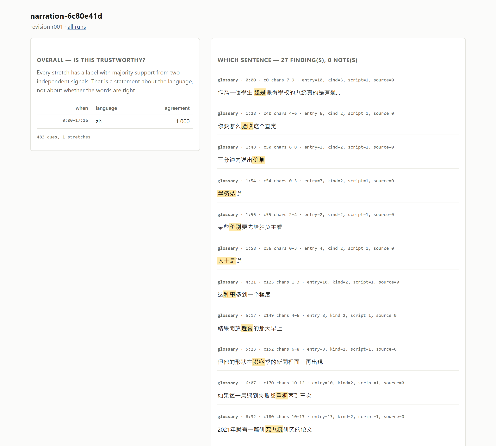
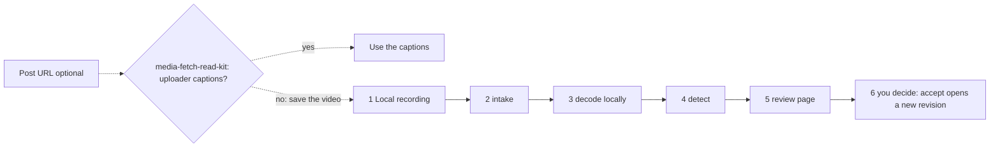

<div align="center">

# local-transcript-kit

**Transcribe a recording on your own machine, and mark where the transcript was probably misheard.**

A machine transcript never raises its hand where it is wrong. `ltm` transcribes locally with faster-whisper, then looks for suspicious sentences with independent signals: a line repeated over and over, anomalies the decoder reports about itself, and words that sound like a term from your glossary but are written differently. It marks them and says why; whether to change anything is your call. Audio and text never leave your machine.

[繁體中文](README.md) · **English**

[](https://github.com/WizerdBaChe/local-transcript-kit/releases/latest)
[](LICENSE)
[](LICENSE-DOCS)
[](docs/EVIDENCE.md)
[](docs/DEVELOPER.md#環境)
[](docs/DEVELOPER.md#環境)

[Example](#at-a-glance) · [Usage](#usage) · [From a post URL](#starting-from-a-post-url-optional) · [Limits](#limits) · [Developer guide (zh-TW)](docs/DEVELOPER.md) · [For agents](AGENTS.md) · [Changelog](CHANGELOG.md)



<sub>Built by <code>docs/assets/build_assets.py</code>, which starts this repo's <code>python -m ltm.ui.serve --read-only</code> and captures it in a browser. The recording is the author's own 17-minute narration (Traditional Chinese), decoded once on the author's machine, then checked against 15 terms taken from the script (correct forms only; the tool was not told what the mistakes look like). Real mishearings among the 27: 假單 heard as 价单, 假別 as 价别, 人事 as 人士, 選課 as 選客, 重試 as 重视, 亞穩態 as 亚文太, 瑞士起司 as 瑞士启示. <b>Some are false alarms</b>: the engine drifted into Simplified characters midway, so correctly heard words written in Simplified are flagged too (see <a href="#limits">Limits</a>). The page UI is English; the transcript is Chinese.</sub>

</div>

## What it solves

- **A transcript does not tell you where it is wrong.** Fluent text hides a hallucinated sentence, a decoder loop pasted five times, a term heard as a sound-alike. `ltm` does not promise to correct it; it tells you **where to doubt and why**.
- **Two signals before it says "problem".** One signal is a note; two or more independent signals on the same span make a finding. Glossary sound-alikes are their own line: "please look", never an automatic replacement.
- **Nothing is overwritten.** Every decode and every accepted edit opens a new revision (r000, r001, ...); old ones stay, each recording whether a person or an agent made it.
- **People and agents use the same functions.** `--json` is the agent face of every verb (a test pins that both faces call one function); responses carry no free-text field.

## At a glance

```text
$ python -m ltm --root docs/assets/demo/desk plan narration-6c80e41d
run narration-6c80e41d revision r001
  27 finding(s), 0 note(s), 0 proposed edit(s)
  [glossary] c50 chars 6-8  entry=1, kind=2, script=1, source=0
      1:48  三分钟内送出[价单]
```

The glossary that produced it: `docs/assets/demo/lexicon-campus-systems.json` (15 terms, correct forms only).

## Usage

### Hand it to your agent

```text
Read AGENTS.md at https://github.com/WizerdBaChe/local-transcript-kit/tree/v1.0.0 (pin v1.0.0, not main) and follow it:
1. run verify/run_controls.py and compare it with verify/controls_run.txt, then tell me;
2. tell me what the speech engine will download and where, and wait for my yes before setup-runtime.ps1;
3. then set up ltm and show me `ltm agent register --dry-run`.
Do not change any control's verdict; report any difference.
```

### See a result without the speech engine

Python 3.12 only; no network, no API key, no GPU. From the repo root:

```powershell
$env:PYTHONPATH = "reference-impl/src"
python -m ltm --root docs/assets/demo/desk plan narration-6c80e41d
python -m ltm.ui.serve --root docs/assets/demo/desk --read-only
```

### Transcribe your own recording

```powershell
powershell -ExecutionPolicy Bypass -File setup-runtime.ps1   # states the download (~3.1 GB model + packages) and asks first
$env:PYTHONPATH = "reference-impl/src"
python -m ltm intake "talk.m4a"
python -m ltm decode <run>
python -m ltm detect <run> --lexicon my-terms.json        # optional
python -m ltm.ui.serve
```

Output goes to `$LTM_ROOT`, else `<home>/TranscriptDesk`. `ffprobe` must be on PATH. Without a GPU it asks before falling back to the CPU.

### Starting from a post URL (optional)

`ltm` reads local files only. To start from a public post, **[media-fetch-read-kit](https://github.com/WizerdBaChe/media-fetch-read-kit) is recommended, not required**:

1. `mfp probe <url> --write-subs --json`: does the video carry the uploader's captions?
2. `captions`: that is the text; fetch it with `mfp fetch --write-subs`, no transcription needed. `auto-captions` are the platform's own recognition: ask the user which to use.
3. Neither: `mfp fetch <url> --json`, then `ltm intake <file> --from-url <url>`.

**Boundary:** each tool installs and works alone; neither reads the other's folders; you or your agent carry the path and the URL between them. mfp does no speech-to-text; ltm makes no network call except downloading the model at setup. Recipe as a program: [`verify/recipe_mfp_to_ltm.py`](verify/recipe_mfp_to_ltm.py).

## Flow


<sub>Drawn by <a href="docs/assets/build_assets.py"><code>docs/assets/build_assets.py</code></a>; each box maps to a passage listed in <a href="docs/DEVELOPER.md#readme-流程圖對照">the developer guide</a>.</sub>

<details><summary>Text version (mermaid)</summary>



</details>

## What's new (v1.0.0)

- First public release: `ltm` (standard library only), its tests, the agent contract, `setup-runtime.ps1`.
- Output root no longer hard-coded: `--root` > `LTM_ROOT` > `<home>/TranscriptDesk`.
- `intake --from-url / --from-note` records where a file came from (`came_from` in `_intake/<run>.json`); the JSON response carries only a count.
- The media-fetch-read-kit recipe as a runnable program, tested on two invented mfp outputs.
- 5/5 acceptance controls pass, 4 of them two-sided: [`verify/controls_run.txt`](verify/controls_run.txt).

## You want... read...

| You want | Read |
|---|---|
| What is enforced by code vs by process | [`docs/EVIDENCE.md`](docs/EVIDENCE.md) "Enforcement map" |
| The recorded acceptance run | [`verify/controls_run.txt`](verify/controls_run.txt) |
| To adapt it | [`docs/DEVELOPER.md`](docs/DEVELOPER.md) (zh-TW), [`docs/BUILD-SPEC.md`](docs/BUILD-SPEC.md) |
| An agent install | [`AGENTS.md`](AGENTS.md) |
| A read-only agent route | [`llms.txt`](llms.txt) |
| The calling contract | [`reference-impl/src/ltm/AGENTS.md`](reference-impl/src/ltm/AGENTS.md), [`reference-impl/skill/SKILL.md`](reference-impl/skill/SKILL.md) |
| Third-party licences | [`THIRD_PARTY_NOTICES.md`](THIRD_PARTY_NOTICES.md) |

## Limits

- **It does not promise correct words.** It recognises repeats, decoder self-reported anomalies and sound-alikes of terms you give it; any other mistake is invisible to it. The hero narration had 0 findings without a glossary and still contains errors.
- **Mixed Simplified/Traditional output causes false alarms** when the glossary is written in the other script.
- **Two decodes of one file differ** (GPU float16 is not bit-reproducible); do not re-run to "confirm".
- **Less test coverage than the origin:** the detector calibration tests need the author's measured real recordings (other people's speech, not publishable); 11 modules are not collected here and are named in the run.
- **Tested on Windows 11 + Python 3.12 only.** The engine needs a ~3.1 GB model; a GPU is optional (CPU is several times slower).
- **Catches careless changes, not an adversary.** The review page binds to 127.0.0.1 with a per-launch token; it is a single-user tool. See [`docs/EVIDENCE.md`](docs/EVIDENCE.md).
- **LLM correction is off by default** and not part of this acceptance; it sends suspicious sentences off the machine, so it asks every time.

## Author

巴哲 BaChe · [GitHub](https://github.com/WizerdBaChe) · [Website](https://wizerdbache.com/) · [YouTube](https://www.youtube.com/@wizerdbache) · [Threads](https://www.threads.com/@wizerd.bache)

## Licence

Code [MIT](LICENSE); documentation, images and the demo run record [CC BY 4.0](LICENSE-DOCS); third-party material in [`THIRD_PARTY_NOTICES.md`](THIRD_PARTY_NOTICES.md).
