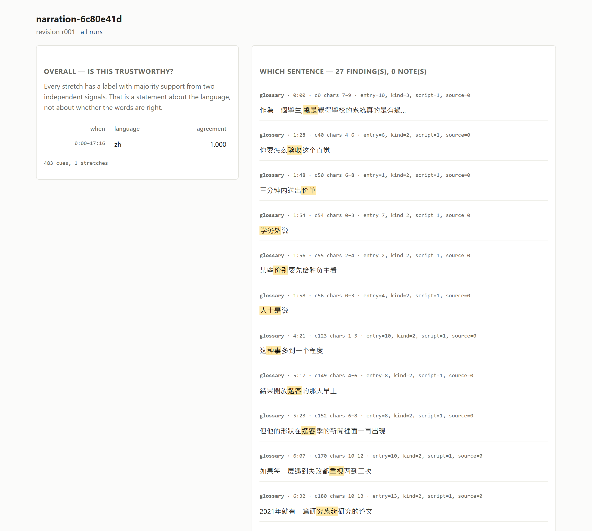
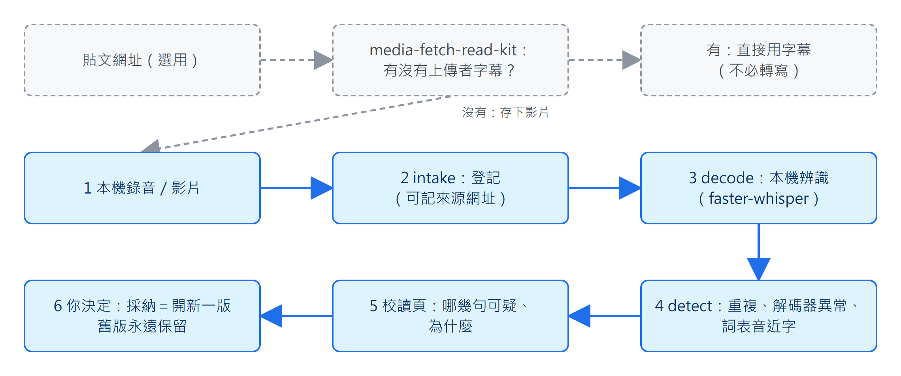
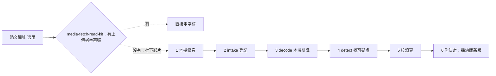

<div align="center">

# local-transcript-kit

**在自己電腦上把錄音轉成逐字稿，並且標出「這裡可能聽錯了」。**

機器逐字稿錯的地方不會自己舉手。`ltm` 用本機的 faster-whisper 轉寫，再用幾個獨立訊號找出可疑的句子：同一句話一直重複、解碼器自己回報的異常、以及你給的術語表裡「音近但寫錯」的詞。它只標出來、說明原因，改不改由你決定；錄音和文字都不離開這台電腦。

**繁體中文** · [English](README.en.md)

[](https://github.com/WizerdBaChe/local-transcript-kit/releases/latest)
[](LICENSE)
[](LICENSE-DOCS)
[](docs/EVIDENCE.md)
[](docs/DEVELOPER.md#環境)
[](docs/DEVELOPER.md#環境)

[看範例](#一眼看懂) · [用途](#用途適合拿來做什麼) · [用法](#用法) · [從貼文網址開始](#從貼文網址開始選用) · [限制](#限制) · [開發者文件](docs/DEVELOPER.md) · [給 agent 的入口](AGENTS.md) · [版本紀錄](CHANGELOG.md)



<sub>上圖由 <code>docs/assets/build_assets.py</code> 啟動本 repo 的 <code>python -m ltm.ui.serve --read-only</code>、用瀏覽器擷取產生。內容是作者自己錄的科普旁白（17 分 16 秒），在作者電腦上實際解碼一次，再給它 15 個從講稿挑出的術語（只給正確寫法，沒有告訴它錯字長什麼樣）。這 15 則裡真的聽錯的有：假單→「价单」、假別→「价别」、人事→「人士」、選課→「選客」、重試→「重视」、亞穩態→「亚文太」、瑞士起司→「瑞士启示」。引擎中途改用簡體字輸出，v1.0.0 會把寫對了的簡體詞（「验收」「学务处」等 12 處）也當成音近字標出來；v1.1.0 不再標，只在計畫檔的 <code>passed_over</code> 計數（見<a href="#限制">限制</a>）。留下來的 15 則仍可能有誤報（例如「研究系统」被當成「舊系統」的音近字），標出來就是請你看一眼。頁面介面是英文，逐字稿是中文。</sub>

</div>

## 它解決什麼

- **逐字稿不會告訴你哪裡錯**：一段通順的中文，看不出哪一句是模型幻聽、哪幾行是解碼器卡住後重複貼上、哪個術語被聽成音近字。`ltm` 不保證幫你改對，它告訴你**該懷疑哪裡、為什麼**。
- **至少兩個訊號才說「有問題」**：單一訊號只記成 note 讓你參考；兩個以上獨立訊號指向同一段，才變成 finding（唯一例外：同一句連續重複 5 次以上，本身就算 finding）。術語表的音近字是另一條線，標成「請你看一下」，不自動替換。
- **改了也不會蓋掉**：每次解碼、每次採納修改都開新的一版（r000、r001…），舊版永遠留著；每一版記下是人還是 agent 做的。
- **人和 agent 用同一套**：指令列加 `--json` 就是 agent 的介面，兩邊呼叫同一個函式（有測試盯著）；回應裡沒有自由文字欄位，agent 讀到的不會摻進可被當成指令的句子。

## 一眼看懂

<table>
<tr>
<td width="50%" valign="top">

**術語表：只給正確寫法，它自己找音近字**<br>
<sub>範例詞表 <code>docs/assets/demo/lexicon-campus-systems.json</code>，15 個詞，全部取自講稿</sub>

```json
{"format": "ltm-lexicon/1",
 "entries": [
   {"term": "假單", "source": "slide"},
   {"term": "選課", "source": "slide"},
   {"term": "亞穩態", "source": "slide"}
 ]}
```

</td>
<td width="50%" valign="top">

**指令列：同一份結果，人看的版本**<br>
<sub><code>python -m ltm plan narration-6c80e41d</code> 的節錄（示範資料就在 repo 裡）</sub>

```text
run narration-6c80e41d revision r002
  15 finding(s), 0 note(s), 0 proposed edit(s)
  [glossary] c50 chars 6-8  entry=1, kind=2, script=1, source=0
      1:48  三分钟内送出[价单]
  [glossary] c183 chars 0-3  entry=11, kind=2, script=1, source=0
      6:40  [亚文太]失效
```

</td>
</tr>
</table>

## 用途（適合拿來做什麼）

- **會議、講座、訪談錄音轉逐字稿**，而且想知道哪些段落要回去聽原音。
- **自己的影片做字幕**：給它講稿裡的術語，它會把被聽成音近字的地方標出來。
- **讓 agent 幫你跑**：`ltm agent guide` 印出呼叫契約；`ltm agent register` 在你指定的設定檔裡寫一段指路文字（只寫在兩個標記之間）。
- **記下錄音從哪裡來**：`ltm intake <檔案> --from-url <網址>` 只記錄、不連網，`ltm show` 會印出來。

**不適合**：要它保證字字正確（它只標可疑處）；即時字幕；說話者分離（沒有）；Windows 以外的系統（沒測過）。

## 用法

### 交給你的 agent 安裝

把下面這段貼給 Claude Code（或其他能讀檔、跑 Python 的 agent）：

```text
請讀 https://github.com/WizerdBaChe/local-transcript-kit/tree/v1.1.0 的 AGENTS.md（固定用 v1.1.0 這個版本，不要用 main），照它的步驟：
1. 先跑 verify/run_controls.py，把結果和 verify/controls_run.txt 對照後告訴我；
2. 告訴我語音引擎要下載多少東西、放在哪裡，等我確認再跑 setup-runtime.ps1；
3. 確認後設定好 ltm，並用 `ltm agent register --dry-run` 給我看它要寫什麼。
不要改任何檢查的判定；有不一致就回報給我。
```

### 不裝語音引擎，先看一次結果

只需要 Python 3.12。不用網路、不用 API 金鑰、不用 GPU。在 repo 根目錄：

```powershell
$env:PYTHONPATH = "reference-impl/src"
python -m ltm --root docs/assets/demo/desk plan narration-6c80e41d
python -m ltm.ui.serve --root docs/assets/demo/desk --read-only
```

第一行印出上面那 15 則；第二行打開校讀頁（只綁本機 `127.0.0.1`，Ctrl-C 關掉後網址就失效）。

### 轉寫你自己的錄音

```powershell
powershell -ExecutionPolicy Bypass -File setup-runtime.ps1   # 先說要下載多少（約 3.1 GB 模型＋套件），問過你才下載
$env:PYTHONPATH = "reference-impl/src"
python -m ltm intake "你的錄音.m4a"        # 印出 run 代號
python -m ltm decode <run 代號>             # 唯一會花時間的一步；17 分鐘錄音在作者的 GPU 上不到 2 分鐘（含載入模型）
python -m ltm detect <run 代號> --lexicon 你的詞表.json   # 選用
python -m ltm.ui.serve                      # 校讀頁
```

輸出放在環境變數 `LTM_ROOT` 指的資料夾；沒設就是家目錄底下的 `TranscriptDesk`。另外需要 `ffprobe`（ffmpeg 的一部分）在 PATH 上。沒有 GPU 時，它會先問你要不要改用處理器跑。

### 從貼文網址開始（選用）

`ltm` 只處理本機檔案。想從公開貼文開始，**建議另外裝 [media-fetch-read-kit](https://github.com/WizerdBaChe/media-fetch-read-kit)**（不是必要的）來抓影片和字幕：

1. `mfp probe <網址> --write-subs --json`：看影片有沒有上傳者字幕。
2. 有上傳者字幕（`captions`）：那就是原文，用 `mfp fetch --write-subs` 抓字幕即可，不必轉寫。平台的機器字幕（`auto-captions`）一樣是辨識結果，先問使用者要用哪一個。
3. 沒有字幕：`mfp fetch <網址> --json` 存下影片，再 `ltm intake <檔案> --from-url <網址>`。

**界線**：兩個工具各自安裝、各自運作，只裝其中一個也完整可用；彼此不讀對方的資料夾，串接由你或你的 agent 做（把路徑和網址帶過去）。mfp 不做語音轉文字；ltm 除了安裝時下載模型以外不連網。完整配方與測試：[`verify/recipe_mfp_to_ltm.py`](verify/recipe_mfp_to_ltm.py)、[`AGENTS.md`](AGENTS.md)。

## 運作流程



<sub>圖由 <a href="docs/assets/build_assets.py"><code>docs/assets/build_assets.py</code></a> 產生，每個方塊對應的程式或文件段落見<a href="docs/DEVELOPER.md#readme-流程圖對照">開發者文件</a>；腳本附幾何自檢（方塊重疊數必須是 0）與故意疊在一起的對照。</sub>

<details><summary>文字版（mermaid）</summary>



</details>

## 這版有什麼（v1.1.0）

- **簡體寫法不再誤報**：引擎中途改用簡體字時，詞表裡的繁體詞若被寫成簡體（验收 對 驗收），`glossary` 不再當成音近字，而是計入 `passed_over["script-variant"]`。規則是單向的：只有「簡體專用字」才視為同一個詞；后、系、价 這類本身也是繁體字的，仍然照標，因為那可能真的是別的詞。示範 run 新增 r002：同一份詞表 15 則（v1.0.0 的 r001 是 27 則，拿掉的 12 則全是簡體寫法）。
- **新偵測器 `script-switch`**：`detect --script hant|hans`（預設預期繁體，不在預設偵測器裡），標出逐字稿離開預期字形的連續段落並計數；只標、不轉換文字。字形表來自 OpenCC（Apache-2.0），見 [`THIRD_PARTY_NOTICES.md`](THIRD_PARTY_NOTICES.md)。
- 驗收新增 K6（示範錄音上的字形規則，兩面對照）：6 項全過，[`verify/controls_run.txt`](verify/controls_run.txt)。
- v1.0.0 的內容：`ltm` 本體（只用 Python 標準函式庫）、測試、agent 契約、`setup-runtime.ps1`。
- **輸出位置不再寫死**：`--root` > 環境變數 `LTM_ROOT` > 家目錄底下的 `TranscriptDesk`。
- **記下檔案從哪裡來**：`intake --from-url / --from-note`，存在 `_intake/<run>.json` 的 `came_from`；agent 的 JSON 回應只帶筆數，不帶網址。
- **和 media-fetch-read-kit 的串接配方**：寫成可執行的 `verify/recipe_mfp_to_ltm.py`，用兩份虛構的 mfp 輸出測過（沒有字幕會走到 intake；有上傳者字幕會停在第 2 步）。

## 你想要……就讀……

| 你想要 | 讀 |
|---|---|
| 知道哪些規則是程式擋的、哪些靠流程 | [`docs/EVIDENCE.md`](docs/EVIDENCE.md) 的 Enforcement map |
| 看驗收實際跑出什麼 | [`verify/controls_run.txt`](verify/controls_run.txt) |
| 改造成自己的版本、看結構圖 | [`docs/DEVELOPER.md`](docs/DEVELOPER.md)、[`docs/BUILD-SPEC.md`](docs/BUILD-SPEC.md) |
| 讓 agent 安裝 | [`AGENTS.md`](AGENTS.md) |
| 只讀不執行的 agent 入口 | [`llms.txt`](llms.txt) 的 Read-only route |
| 給 agent 的呼叫契約（英文） | [`reference-impl/src/ltm/AGENTS.md`](reference-impl/src/ltm/AGENTS.md)、[`reference-impl/skill/SKILL.md`](reference-impl/skill/SKILL.md) |
| 原作者的使用說明（中文，較長） | [`reference-impl/README.md`](reference-impl/README.md) |
| 第三方材料的授權 | [`THIRD_PARTY_NOTICES.md`](THIRD_PARTY_NOTICES.md) |

## 限制

- **它不保證字對**：偵測器只認得「重複」「解碼器自報異常」與「你給的術語的音近字」。一句聽起來怪但不屬於這三類的錯字，它看不到；主圖那份旁白在沒有詞表時是「0 則」，但裡面其實有錯字。
- **繁簡字形只做單向比對**：詞表詞被寫成簡體專用字時會略過並計數；但后、系、价 這類本身也是繁體字的，仍會照標，這是刻意的取捨。`script-switch` 只告訴你哪一段換了字形，不轉換、也不判斷對錯。
- **同一個檔案解兩次，結果不會一模一樣**：GPU 上的 float16 解碼不是位元可重現的；不要用重跑來「確認」上一次。
- **公開版的測試涵蓋面比原作者的少**：偵測器的校正測試要用作者的真實錄音量測（別人的講話，不能公開），在這裡不收集，會明列 12 個模組；驗收紀錄寫了實際數字。
- **只在 Windows 11 + Python 3.12 實測**；語音引擎需要約 3.1 GB 模型，GPU 可選（沒有就改用處理器，慢好幾倍）。
- **防粗心，不防刻意繞路**：測試擋得住誤改（例如產品裡多一個網路模組）；不是對抗性的安全證明。校讀頁只綁本機、每次啟動換新的權杖，但這是單機單人工具。程式擋與流程擋的對照見 [`docs/EVIDENCE.md`](docs/EVIDENCE.md)。
- **LLM 校正預設關閉**：原作者的版本可以在你同意後請 Claude 挑選校正；那一步會把可疑句子送出本機，所以每次都要先問，而且不在這份驗收裡。
- 更多限制與人工驗收清單：[`docs/DEVELOPER.md`](docs/DEVELOPER.md#限制)。

## 作者

巴哲 BaChe · [GitHub](https://github.com/WizerdBaChe) · [網站](https://wizerdbache.com/) · [YouTube](https://www.youtube.com/@wizerdbache) · [Threads](https://www.threads.com/@wizerd.bache)

## 授權

程式碼 [MIT](LICENSE)；文件、圖片與示範紀錄 [CC BY 4.0](LICENSE-DOCS)；第三方材料見 [`THIRD_PARTY_NOTICES.md`](THIRD_PARTY_NOTICES.md)。
