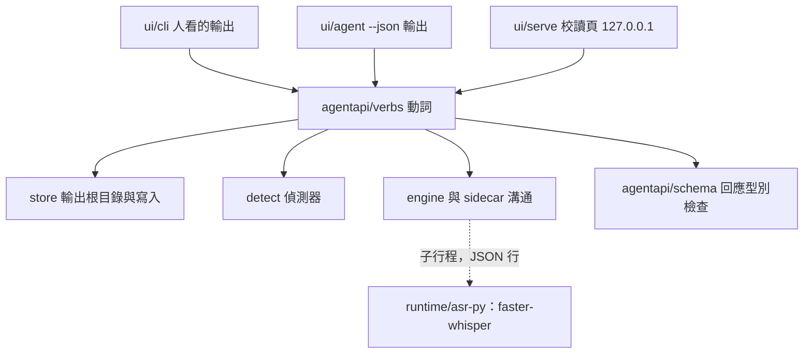

# 開發者文件（DEVELOPER）

給要改造、驗證或重建這個 repo 的人。介紹與用法在 [`../README.md`](../README.md)；給 agent 的規格在
[`BUILD-SPEC.md`](BUILD-SPEC.md)；量測與「哪條規則由程式擋」在 [`EVIDENCE.md`](EVIDENCE.md)。

## 結構

```
local-transcript-kit/
├── README.md / README.en.md      介紹頁（中文為主、英文鏡像）
├── AGENTS.md / llms.txt          給 agent：先列事實，再列安裝步驟；llms.txt 是機器索引
├── setup-runtime.ps1             建語音引擎（venv + 模型，SHA-256 檢查），先問才下載
├── reference-impl/               原專案 ltm 的位元組拷貝（例外見 BUILD-SPEC §9）
│   ├── src/ltm/
│   │   ├── core/       資料模型、編號、編輯腳本、進度
│   │   ├── store/      輸出根目錄 (layout)、寫入、來源記錄 (came_from)
│   │   ├── engine/     與獨立直譯器裡的 faster-whisper 溝通 (sidecar, channel, contract)
│   │   ├── detect/     偵測器：重複、解碼器異常、詞表音近字；門檻與評分
│   │   ├── agentapi/   動詞 (verbs) 與回應型別 (schema；回應不得含自由文字)
│   │   ├── ui/         命令列 (cli)、agent 面 (agent)、本機校讀頁 (serve)
│   │   └── AGENTS.md   呼叫契約（`ltm agent guide` 印出的就是它）
│   ├── tests/         原專案的測試；conftest.py 附公開版區塊 (E3)
│   └── skill/SKILL.md 給 Claude Code 類 agent 的技能檔
├── verify/           驗收：run_controls.py、串接配方、虛構的 mfp 輸出、紀錄
└── docs/
    ├── BUILD-SPEC.md / EVIDENCE.md / DEVELOPER.md
    └── assets/        README 圖、產圖腳本、示範 run 紀錄與詞表
```

## 元件關係



兩個「面」（給人看的 CLI、給 agent 的 `--json`）呼叫同一個函式（`tests/test_agentapi_schema.py`）；
`ui/agent` 這個命名空間不得 import store、engine 或偵測器（`tests/test_two_faces.py`），其他 `ui` 模組可以。產品本體只用標準函式庫、不得 import 網路模組（`tests/test_layering.py`）。
faster-whisper 跑在 `runtime/asr-py` 這個獨立直譯器裡，產品透過子行程和它交換 JSON 行。

## README 流程圖對照

README 的流程圖由 `docs/assets/build_assets.py` 的 `FLOW` 表畫出；每個方塊對應的段落：

| 方塊 (`FLOW` id) | 圖上文字 | 對應的程式或文件 |
|---|---|---|
| `url` | 貼文網址（選用） | README「從貼文網址開始（選用）」；`AGENTS.md`「Starting from a post URL」 |
| `mfp` | media-fetch-read-kit：有沒有上傳者字幕？ | `verify/recipe_mfp_to_ltm.py` `step2`（讀 probe 的 `sidecars[].kind`）；BUILD-SPEC §5 |
| `subs` | 有：直接用字幕 | 同上，exit 10（`captions`）；`auto-captions` 則 exit 11 先問使用者 |
| 邊 `mfp→rec` | 沒有：存下影片 | `recipe_mfp_to_ltm.py` `step3`（讀 fetch 的 `items[].path`，以 `index` 對回 probe） |
| `rec` | 1 本機錄音／影片 | README「轉寫你自己的錄音」 |
| `intake` | 2 intake：登記（可記來源網址） | `reference-impl/src/ltm/agentapi/verbs.py` intake；`store/came_from.py`（`--from-url / --from-note`） |
| `decode` | 3 decode：本機辨識 | `engine/runner.py`、`engine/sidecar.py`；`setup-runtime.ps1` 建的 runtime |
| `detect` | 4 detect：重複、解碼器異常、詞表音近字 | `detect/detectors.py`、`detect/signals.py`、`detect/soundalike.py`、`detect/lexicon.py` |
| `plan` | 5 校讀頁：哪幾句可疑、為什麼 | `ui/serve.py`；`ltm plan` 的 `_plans/rNNN.json` |
| `decide` | 6 你決定：採納＝開新一版 | `accept` 動詞；BUILD-SPEC §4（舊版永不改寫） |

改流程圖時改 `FLOW` / `EDGES` / `EDGE_LABEL`，再重跑腳本；README 裡的 mermaid 文字版要一起改。

## 環境

- Windows 11、Python 3.12（實測 3.12.7）。產品本體不需要任何第三方套件；測試需要 pytest（`verify/requirements.txt` 固定 9.1.1）。
- 轉寫需要：`setup-runtime.ps1` 建的 `reference-impl/runtime/`（faster-whisper 1.2.1、約 3.1 GB 模型）與 PATH 上的 `ffprobe`。
- 環境變數：`LTM_ROOT`（輸出根目錄）、`LTM_SIDECAR_PYTHON`、`LTM_MODEL_DIR`（引擎位置，預設在 runtime/ 底下）。
- 重產 README 圖：另外需要 playwright + chromium（`verify/requirements.txt` 裡註解掉的那行）。

## 怎麼驗證

```powershell
python -m pip install -r verify/requirements.txt
python -X utf8 verify/run_controls.py <一個新的空資料夾>
```

對照 [`verify/controls_run.txt`](../verify/controls_run.txt)：5 行都是 `PASS`，最後一行 `SUMMARY: 5/5 controls pass`。
K2–K5 是兩面對照：同時印出正常值與故意弄壞時的值，兩者必須不同。驗收不會啟動語音引擎、不連網。

## 刻意的設計

- **兩個工具互不讀對方**：mfp 與 ltm 的串接由 agent 做（帶路徑和網址），不是誰呼叫誰；只裝其中一個也完整可用。
- **網址不進 `--json`**：agent 回應只有識別碼與封閉集合的狀態，網址只存在磁碟上與人看的輸出（INV-12）。
- **修訂不改寫**：`accept` 開新一版，舊版保留，誤判可以退回。
- **LLM 不在產品裡**：要不要請 LLM 挑校正候選，由呼叫的 agent 每次問使用者。

## 限制

README「限制」一節是摘要，這裡列全部：

- 偵測器只涵蓋三類錯誤（重複、解碼器自報異常、詞表音近字）；其他錯字看不到。示範旁白沒有詞表時 0 則，但實際有錯字（例如「錯誤物頁」「路口網站」沒被標出）。
- 詞表比對分繁簡：引擎中途改用簡體時，寫對的簡體詞會被當成音近字（示範 27 則中有 验收、学务处、旧系统、选课、入口网站 這類誤報）。這是 ltm 的缺陷，尚未修。
- 11 個測試模組需要原作者的量測錄音與完整規格，公開版不收集（K1 會列名）；偵測器門檻的校正在這裡沒有重驗。
- GPU float16 解碼不是位元可重現；兩次 decode 結果不同是預期的。
- 只在 Windows 11 + Python 3.12 實測。`setup-runtime.ps1` 依賴 PyPI 與 Hugging Face 上的檔案持續存在；檔案變了會在 SHA-256 檢查失敗。
- 測試防粗心，不防刻意繞路；校讀頁只綁本機並每次換權杖，但這是單機單人工具。
- `reference-impl/CLAUDE.md`、`reference-impl/README.md` 是原作者寫給自己的文件，引用了沒附的紀錄（`verify/unshipped_paths.txt`）。

## 人工驗收

### A 必驗

1. 在乾淨資料夾跑 `verify/run_controls.py`，5/5 PASS，數字與 `controls_run.txt` 相符。
2. 不裝引擎跑 README「先看一次結果」兩行：第一行印出 27 則，第二行開出的校讀頁與 `docs/assets/hero.png` 一致。
3. 校讀頁網址只在 `127.0.0.1`；Ctrl-C 關掉後重開同網址會失效。
4. 跑 `setup-runtime.ps1`：先列出下載量與位置並等你確認；拒絕時不寫任何檔案。
5. 用自己一段短錄音走 intake → decode → plan，輸出落在 `LTM_ROOT`（沒設則家目錄的 `TranscriptDesk`），原檔沒被改。
6. `intake --from-url` 後，`--json` 回應只有 `came_from_count`，網址只出現在人看的輸出與 `_intake/<run>.json`。

### B 體驗

1. README 首屏能不能一眼看出「它會標出哪幾句不可信、為什麼」。
2. 校讀頁上一則誤報（例如簡體的「验收」）能不能看懂原因並略過。
3. 有 mfp 時，從貼文網址走配方是否順；沒有 mfp 時，文件是否清楚表示那是選用的。

## 重產 README 圖

```powershell
python -m pip install playwright
python -m playwright install chromium
python -X utf8 docs/assets/build_assets.py
```

它以唯讀模式啟動 `docs/assets/demo/desk/` 的校讀頁截主圖（並確認頁面顯示 27 則），再從 `FLOW` 表畫流程圖（中英各一張），
附幾何自檢（方塊重疊必須為 0）與故意疊在一起的對照（必須大於 0）。示範 run 本身不在這裡重建：那需要原錄音與語音引擎，
是 `docs/assets/capture_demo_desk.py` 在作者機器上複製一次、把錄音路徑改寫成 `recording/<name>` 的結果。
